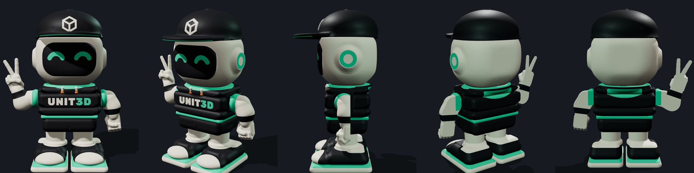
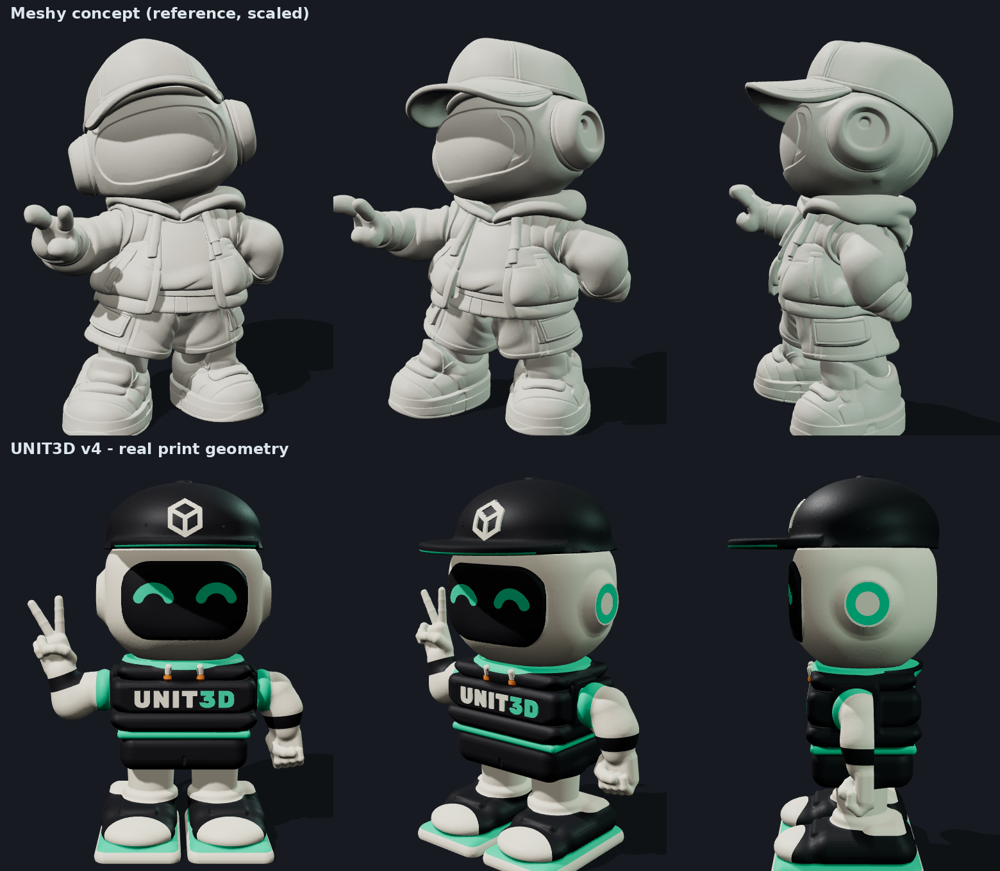
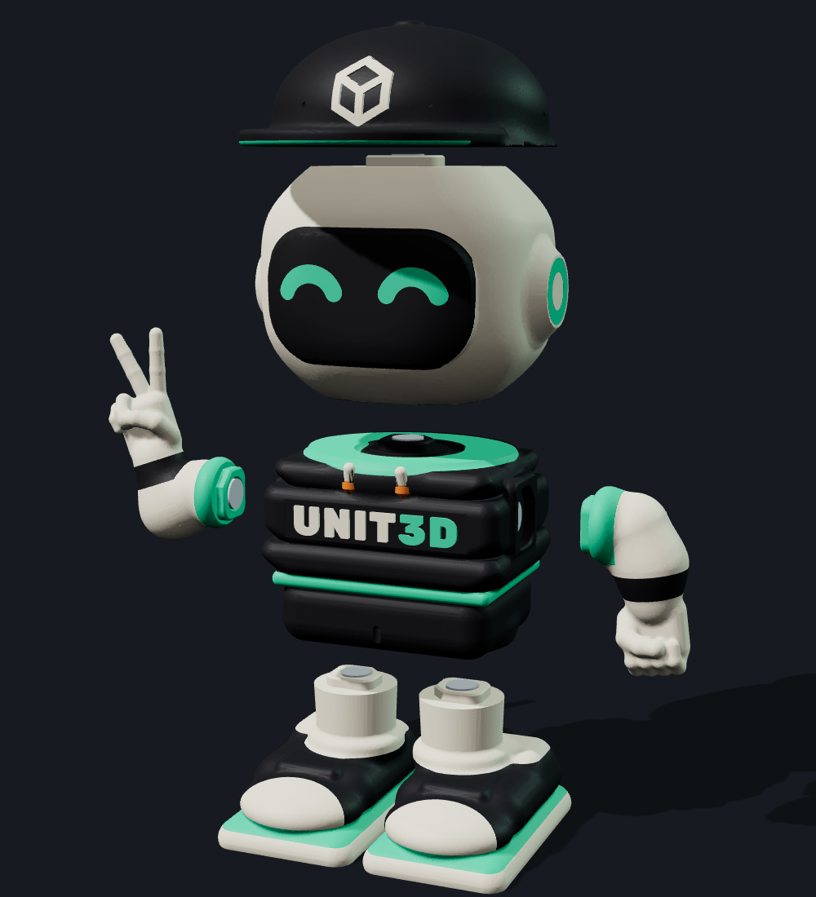

# UNIT3D – קמע רובוט מודולרי מגנטי (קובצי הדפסה, גרסה 4)

קובצי הדפסה ל-Bambu Lab P2S Combo עם AMS. הגובה המורכב הוא 120.0 מ"מ. יש 7 חלקים מתחברים: כובע, ראש, גוף/חזה, שתי ידיים ושתי רגליים. החיבורים מגנטיים, עם 12 מגנטים בגודל 6×2 מ"מ שנוגעים זה בזה ישירות.

**גרסה 4 בנויה לפי קובצי Meshy שנשלחו להכוונה.** היא נשארת בסגנון צ׳יבי, וגם הגוף שמנמן:
- **ראש:** גדול ומעוגל, עם אוזניות מסוג headphone. האוזניות בנויות כקונוס ב-45° כדי שיודפסו בלי תמיכות.
- **גוף:** וסט פאפר מרופד בשלוש "צינורות", ומכנסיים רחבים.
- **רגליים:** קצרות ועבות, עם סניקרס גדולות (רוחב העמידה כ-57 מ"מ).
- **ידיים:** שרוולים עבים. כפות הידיים גדולות ב-40%: סימן V ואגרוף. אין ברכיים ואין מרפקים.

| קובץ | מה זה |
|---|---|
| `UNIT3D_Mascot_P2S_4plates.3mf` | פרויקט Bambu Studio הראשי: 4 פלטות, חלקים לפי צבע, הגדרות שמורות |
| `UNIT3D_Magnet_Test_Coupon_P2S.3mf` | דוגמית לבדיקת כיסי המגנטים. **להדפיס ראשונה** |
| `UNIT3D_Mascot_P2S_full_package.zip` | הכל: STL לכל חלק ולכל צבע, STEP, תמונות, קוד מקור, דוחות והוראות |
| `UNIT3D_הוראות_הרכבה.pdf` | הוראות הדפסה והרכבה בעברית |
| `checks.json` | תוצאות הבדיקות הגאומטריות |
| `source/` | הקוד הפרמטרי שמייצר את הכל (`python3 export_all.py`) |

**חריצי AMS:** 1 קרם · 2 שחור/פחם · 3 מנטה · 4 כתום.

**מגנטים:** כיס בקוטר 6.25 מ"מ ובעומק 1.8 מ"מ, כך שהמגנט בולט 0.2 מ"מ. בכל חיבור יש בליטת יישור בגובה 2 מ"מ עם פינה קטומה, ולכן כל חלק נכנס בכיוון אחד בלבד.

הקבצים נבדקו גאומטרית: רשתות סגורות, אין התנגשויות, המגנטים נוגעים, ומידות הכיסים נמדדו על הרשת. הם עברו גם Slice ב-PrusaSlicer, ומבנה ה-3MF נבדק מול קוד הטעינה של Bambu Studio. **הם לא נפתחו ב-Bambu Studio עצמו**, ולכן צריך לעשות Slice ולהדפיס את הדוגמית לפני הדפסה מלאה. את הפירוט המלא אפשר למצוא ב-PDF, בסעיף 9.
